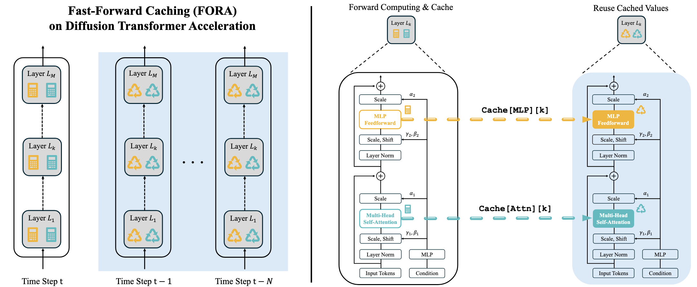

# FORA: Fast-Forward Caching in Diffusion Transformer Acceleration

An easy-to-use implementation of FORA for efficient diffusion transformers (DiTs).

## ✨Introduction

> **Abstract:** Diffusion transformers (DiT) have become the de facto choice for generating high-quality images and videos, largely due to their scalability, which enables the construction of larger models for enhanced performance. However, the increased size of these models leads to higher inference costs, making them less attractive for real-time applications. We present Fast-FORward CAching (FORA), a simple yet effective approach designed to accelerate DiT by exploiting the repetitive nature of the diffusion process. FORA implements a caching mechanism that stores and reuses intermediate outputs from the attention and MLP layers across denoising steps, thereby reducing computational overhead. This approach does not require model retraining and seamlessly integrates with existing transformerbased diffusion models. Experiments show that FORA can speed up diffusion transformers several times over while only minimally affecting performance metrics such as the IS Score and FID. By enabling faster processing with minimal tradeoffs in quality, FORA represents a significant advancement in deploying diffusion transformers for real-time applications. Code will be made publicly available at: https://github.com/prathebaselva/FORA.



## 📋TODO List

- [x] Implement fixed-interval feature caching.
- [x] Support FLUX.1-dev through Diffusers.
- [x] Add DrawBench generation, scoring, and report export.

## 📦Installation

Install with [uv](https://github.com/astral-sh/uv) and Python 3.12 or later.

```bash
git clone https://github.com/FANtier-Labs/FORA.git
cd FORA
uv sync
```

For DrawBench, run `uv sync --extra eval`.

## 🚀Quickstart

```python
import torch
from diffusers import FluxPipeline
from fora import CacheManager, FluxAdapter, FORAConfig

pipe = FluxPipeline.from_pretrained(
    "black-forest-labs/FLUX.1-dev", torch_dtype=torch.bfloat16
).to("cuda")
pipe.transformer.eval()

manager = CacheManager(FORAConfig(interval=3))
with FluxAdapter().patch(pipe, manager):
    image = pipe("A lighthouse in the fog").images[0]

image.save("flux_fora.png")
```

Use one patch context per pipeline call and keep Diffusers' native caching disabled. An interval of 3 refreshes features at steps 0, 3, 6, and so on. An interval of 1 runs full computation at every step.

## 🔌Adapters

`FluxAdapter` supports standard guidance and true CFG in Diffusers' `FluxPipeline`. The CUDA demo reports inference time and peak allocated memory.

```bash
uv run python -m playground.flux --enable-fora --interval 3 \
  --prompt "A cat holding a sign that says hello world" --output-path outputs/flux.png
```

Omit `--enable-fora` to run the baseline.

## 📊Evaluation

We evaluated FLUX.1-dev on 200 DrawBench prompts with one image per prompt, matched seeds, 50 denoising steps, 1024 × 1024 resolution, and guidance scale 3.5. Runs used two NVIDIA RTX PRO 5000 72GB Blackwell GPUs with one untimed warmup per worker. Latency is mean pipeline time per image.

| Method | Latency (s) ↓ | Speedup ↑ | CLIP Score ↑ | PSNR (dB) ↑ | SSIM ↑ | LPIPS ↓ |
| --- | ---: | ---: | ---: | ---: | ---: | ---: |
| FLUX.1-dev | 28.68 | 1.00× | 0.3162 | — | — | — |
| FORA ($\mathcal{N}=2$) | 14.97 | 1.92× | 0.3152 | 17.624 | 0.7448 | 0.3003 |
| FORA ($\mathcal{N}=3$) | 10.58 | 2.71× | 0.3152 | 15.647 | 0.6798 | 0.3972 |
| FORA ($\mathcal{N}=4$) | 8.47 | 3.39× | 0.3149 | 14.770 | 0.6492 | 0.4449 |
| FORA ($\mathcal{N}=5$) | 6.74 | 4.25× | 0.3147 | 14.192 | 0.6154 | 0.4891 |
| FORA ($\mathcal{N}=6$) | 6.19 | 4.64× | 0.3120 | 13.926 | 0.6107 | 0.5104 |
| FORA ($\mathcal{N}=7$) | 5.64 | 5.09× | 0.3118 | 13.731 | 0.5997 | 0.5326 |

CLIP Score measures image–prompt alignment. PSNR, SSIM, and LPIPS compare each FORA image with its matched baseline.

## 🎨Visualizations

> **Visualization PlaceHolder:** Add qualitative comparisons of FORA with different refresh interval.

## 👏Acknowledgement

Thanks to the authors of the [original FORA implementation](https://github.com/pratheba/FORA) and the [Diffusers](https://github.com/huggingface/diffusers) contributors.
